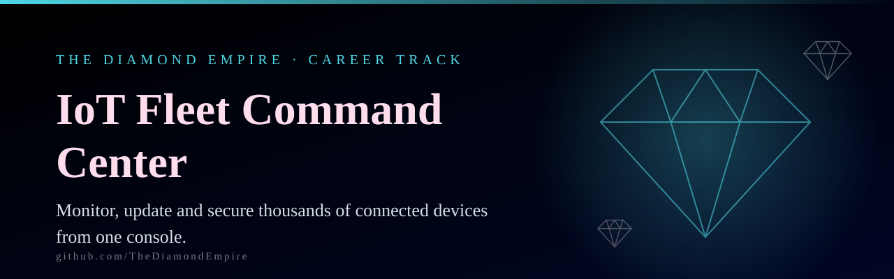
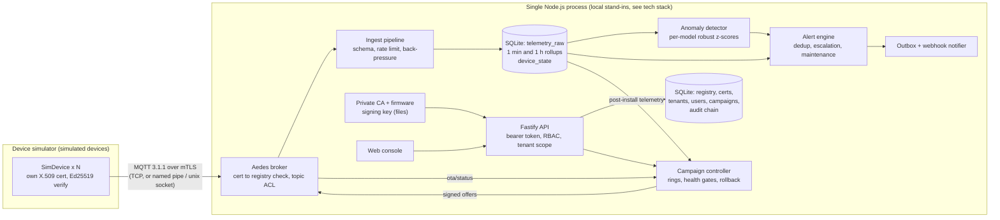

<p align="center"></p>

<p align="center">
  
  
  
</p>

# IoT Fleet Command Center

> Monitor, update and secure thousands of connected devices from one console.

A device-fleet operations platform for makers and operators of connected equipment. It ingests telemetry over MQTT with mutual-TLS device identity, tracks health and connectivity, rolls out signed firmware in staged waves with health gates and automatic rollback, and raises de-duplicated, escalating alerts. Everything in this repository has been run against **simulated devices only**; there is no real hardware and no production deployment.

**Quick links:** [Architecture](#architecture) · [Tech stack](#tech-stack) · [Engineering decisions](#engineering-decisions) · [Roadmap](#roadmap) · [Case study](docs/case-study.md) · [Research report](docs/research-report.md)

> **Public showcase.** This repository holds the documentation, client case study, research report and measured results for this product. The runnable source code is distributed separately under a license: see [SOURCE-ACCESS.md](SOURCE-ACCESS.md).

## At a glance

|                    |                                                                                                                                                                                                                              |
| ------------------ | ---------------------------------------------------------------------------------------------------------------------------------------------------------------------------------------------------------------------------- |
| **Track**          | Career · Advanced                                                                                                                                                                                                            |
| **Phase**          | Beta: all five milestones are built and tested (69 automated tests: 68 pass, 1 skips itself on this machine), and all four experiments have recorded results. Everything runs against simulated devices on one shared development machine; there is no real hardware, no deployment, and the CI workflow has never been run. |
| **Primary reader** | Hiring managers and engineering leads                                                                                                                                                                                        |
| **Read next**      | [README](README.md) · [Client case study](docs/case-study.md) · [Research report](docs/research-report.md) · [Threat model (draft)](docs/threat-model.md)                                                                     |

## Why this exists

Companies that ship connected equipment often learn about failures from customers. Firmware updates are risky all-or-nothing events, telemetry is scattered across tools, and nobody can say which devices run which version or which are about to fail.

## What it does

Only what is built and tested is listed here. Unbuilt items are under [Not built yet](#not-built-yet--out-of-scope).

- **Device registry and identity.** Tenants, devices (model, hardware revision, group, tags), a private CA that issues per-device X.509 certificates (CSR flow, or server-generated keys for development), certificate rotation, and revocation that takes effect at the broker immediately.
- **MQTT ingestion.** An in-process broker (Aedes) that accepts only mutual-TLS clients whose certificate is in the registry, binds `clientId` to the certificate identity, enforces a per-device topic ACL, validates every telemetry message against a strict schema, applies a per-device token-bucket rate limit, and pauses reading from publishers when storage cannot keep up.
- **Telemetry storage.** Batched SQLite writes with 1-minute and 1-hour rollups, raw retention pruning, and a latest-state row per device.
- **Fleet health and alerts.** Fleet and per-device health views; rules for offline devices, window-average thresholds and per-model anomaly detection (battery decay, sensor drift); alert de-duplication, escalation levels, maintenance windows, acknowledgement, and an outbox/webhook notifier.
- **Signed staged OTA.** Ed25519-signed firmware manifests, per-device short-lived signed offers, device-side verification (signature, hash, target, expiry, replay, anti-rollback counter), campaigns with rings and a deterministic per-campaign ring assignment, and a live ring-progress view.
- **Health gates and rollback.** Gates on install failures, silent devices and post-install error and reboot rates; automatic pause; automatic or manual rollback to a known-good image re-issued under a higher counter.
- **Multi-tenant RBAC and audit.** Viewer, operator and admin roles, strict tenant scoping on every query, and a per-tenant hash-chained audit trail with a verify endpoint.
- **Console.** A small web console (fleet and devices, campaigns with ring progress, alerts, audit log) served by the API.
- **Device simulator.** Async devices in one process, each with its own certificate, that publish telemetry, verify firmware signatures, install images (with a simulated A/B revert) and can misbehave: bad image (boot loop, degraded, hang), battery decay, sensor drift, connectivity churn.

## Architecture



Topics: `t/{tenant}/d/{device}/tele` and `.../ota/status` (device to cloud), `.../ota/offer` and `.../cmd` (cloud to device; `cmd` is reserved and unused). A device can only touch its own subtree.

## Tech stack

The blueprint's stack was a proposal. This table says what was actually used and what production would use in its place.

| Layer          | Used here                                                                                         | Production would use                                                           |
| -------------- | ------------------------------------------------------------------------------------------------- | ------------------------------------------------------------------------------ |
| Language       | TypeScript (strict) on Node 25, run directly with Node's built-in type stripping, no build step  | Same, compiled and containerised                                               |
| Console        | Plain HTML, CSS and JavaScript served by the API (no framework, no build)                         | Next.js or similar, behind SSO                                                 |
| API            | Fastify 5, bearer API tokens (only SHA-256 stored), RBAC                                          | Behind an API gateway, OIDC/SSO, rate limiting                                 |
| MQTT broker    | Aedes (pure JS, in-process), MQTT 3.1.1, TLS 1.2+ with client certificates                        | EMQX or Mosquitto cluster, MQTT 5, load balancer, broker-level auth            |
| Event stream   | In-process bounded queue with back-pressure                                                       | Kafka-compatible stream (Redpanda) between broker and ingest workers           |
| Registry data  | `node:sqlite` (built into Node)                                                                   | PostgreSQL                                                                     |
| Telemetry data | `node:sqlite` with application-maintained 1 min / 1 h rollups                                     | TimescaleDB continuous aggregates or ClickHouse                                |
| PKI            | `@peculiar/x509`, ECDSA P-256 private CA, keys in gitignored files                                | HSM-backed CA or managed private CA, automated enrolment and renewal, CRL/OCSP |
| Firmware trust | Ed25519 (`node:crypto`), one signing key in a file                                                | HSM/KMS signing service with approvals, key rotation, several trusted keys     |
| Firmware store | Image bytes inline in the MQTT offer (256 KB cap)                                                 | Object storage with signed, resumable downloads                                |
| Simulation     | Async simulator in one process; load generator with hand-built MQTT packets in separate processes | Distributed across hosts, plus hardware-in-the-loop                            |
| Tests          | `node:test`, ESLint, Prettier, `tsc --noEmit`                                                     | Same, plus device-level conformance tests                                      |
| Delivery       | A GitHub Actions workflow file (never run, see below)                                             | Docker, Kubernetes manifests, Terraform, GitHub Actions                        |

## Engineering decisions

### Rollouts are gated by fleet health, not by a timer

Each ring advances only if the share of "bad" devices stays within a threshold. A device is bad if it failed to install, went silent after installing, or reports a post-install error or reboot rate above per-device limits. A tripped gate pauses the campaign and, when a known-good image was supplied, rolls the updated devices back. Experiment E1 measures how well this works and where it does not: a fault that affects few devices can slip past a small canary ring.

### Device identity is cryptographic

Every device holds its own certificate, so a stolen credential affects one device. The registry sets the certificate subject, the broker binds `clientId` to it, and revocation is checked at TLS accept and again at CONNECT and drops the live session. Firmware offers are signed per device and per campaign, expire quickly, and the device refuses replays and any image whose anti-rollback counter is not higher than its own. Rollback therefore re-issues the known-good image under a _higher_ counter instead of weakening the check.

### Tenant isolation is structural

The tenant id is taken from the authenticated principal and from nowhere else. No API route accepts a tenant id, every repository function takes it as a mandatory argument, and another tenant's resource is answered with 404. Adversarial tests attack every by-id route from a second tenant.

### Simulate before you scale

The simulator drives both the integration tests and the experiments. Scale numbers in this repository are what was actually reached on one shared machine with the system under test limited to two cores, not projections.

### Loopback TLS on the development machine

On the Windows machine this was built on, security software re-signs TLS on loopback TCP, which makes client-certificate authentication impossible to test over TCP. TLS is identical over a Windows named pipe, so the tests and experiments run mTLS over a named pipe (a Unix socket on Linux and macOS), and `npm start` detects the problem and falls back to it with a warning. The TCP listener is the default when nothing interferes. One test exercises it and **skips itself on this machine**, so the TCP path is untested here.

## Measured results

All numbers come from scripts in `experiments/` writing to `results/`, on **simulated** devices, on a shared machine that was at 100% CPU busy before most runs (64.6% before one). See the [research report](docs/research-report.md) for hardware, load, run counts, confidence intervals and threats to validity.

| Experiment | Headline (simulated devices, shared machine) | Verdict on the hypothesis |
| --- | --- | --- |
| E1 rollout safety | Gated rollout: faulty image ran on 5% of the fleet (the 5-device canary) in 40 of 40 runs for degraded p = 1.0 and 0.3, boot-loop and hang faults, vs 100% for ungated and for timer-staged rollouts. With only 10% of devices affected, mean exposure was 31% (95% CI 10.5% to 53.0%) and only 6 of 10 runs stayed within the canary. No false pauses on a healthy image (0 of 10). | H1 supported for faults on at least 30% of devices, not as worded for rare faults |
| E2 early detection | Per-model anomaly rule: 97.6% of failing devices flagged at least 24 h before failure (CI 96.7% to 98.5%), 0 of 3,200 healthy device-fleets flagged, median lead 91 h. Static thresholds: 54.8% (battery < 20%), 84.0% with 17.9% of healthy devices flagged (battery < 30%), 21.5% (sensor range). | H2 supported in the simulation (author-written simulator, clean noise) |
| E3 ingest scaling | At least 8,000 simulated devices at 0.1 msg/s passed (p99 commit latency about 65 ms); the 16,000-device step was skipped by a memory guard, so **no device-count ceiling was reached** and nothing is extrapolated. At 500 devices, 4,000 msg/s passed every repetition of the main run on two cores (p99 under 0.32 s; it failed once in the one-core supplement); 8,000 msg/s was borderline and run-to-run results disagreed. One core performed like two. | H3 not supported as worded (no worker count to vary; 100,000 devices not tested) |
| E4 identity overhead | mTLS added +55.6% to connect time (CI +47.7% to +63.6%) and +56.4% to broker CPU per connection over TLS with a shared secret (named pipe, full handshakes). | H4 not supported |

The E3 run was repeated after harness fixes; the earlier complete run, which disagrees on neighbouring steps, is kept as `results/e3-prelim-*` and discussed in the report.

## Quality bar

- Strict TypeScript, ESLint and Prettier configured. `npm run check` runs the type check, lint, format check and the full test suite.
- 69 tests across 9 files (`node:test`): 68 pass and 1 is skipped (mTLS over loopback TCP, which this machine intercepts). Unit and integration coverage per milestone: M1 identity and ingest (18), M2 alerts and API (9), M3 signing and campaigns (16), M4 gates and rollback (9), M5 tenancy and audit (17). Last full run from a clean `npm ci`: typecheck, lint and format check clean.
- Adversarial tests: tenant isolation (route sweep, list leaks, id smuggling, injection-shaped ids); tampered, forged, replayed, misdirected, expired and downgraded firmware (unit tests and over the wire); tampered audit chains.
- A draft threat model maps each threat to the test that covers it and lists the known gaps: [docs/threat-model.md](docs/threat-model.md). Nobody else has reviewed it.
- No secrets are committed: the CA, broker key and firmware signing key are generated into the gitignored `certs/` by `npm run setup`; demo API tokens go to the gitignored `.dev/`.
- `.github/workflows/ci.yml` runs the same commands as local. **It has never been run**: it could not be executed where this was built.

## Roadmap

- [x] M1: device registry, mTLS identity and MQTT ingestion for the simulator
- [x] M2: telemetry storage, fleet health views and alert rules
- [x] M3: signed OTA campaigns with staged rings
- [x] M4: health gates, automatic pause and rollback
- [x] M5: multi-tenancy, RBAC and the audit trail
- [x] Experiments E1 to E4 run with recorded results (`results/`)
- [ ] Remote configuration and commands with acknowledgements
- [ ] Real hardware or hardware-in-the-loop validation
- [ ] First green run of the CI workflow
- [ ] Independent review of the threat model

## Not built yet / out of scope

| Item                                                                            | Why                                                                                                      |
| ------------------------------------------------------------------------------- | -------------------------------------------------------------------------------------------------------- |
| Remote configuration and commands with acknowledgements                         | Cut to keep the five milestones verified; the `cmd` topic is reserved and ACL-protected but unused       |
| 100,000-device load test                                                        | Not reached: the research report states the ceiling actually measured here, and nothing is extrapolated  |
| EMQX/Mosquitto cluster, Redpanda, TimescaleDB/ClickHouse, Kubernetes, Terraform | No daemon-based infrastructure was available or needed; stand-ins sit behind plain classes               |
| Real devices, real networks, field failure data                                 | None available: every fault and every metric is simulated                                               |
| HSM/KMS signing, key rotation, CRL/OCSP, automated certificate renewal          | Keys are files; see the threat model                                                                     |
| SSO, token expiry, API rate limiting, HTTPS for the API                         | API tokens only, bound to 127.0.0.1                                                                      |
| Resumable firmware download, delta updates                                      | Images travel inline in the MQTT offer                                                                   |
| MQTT 5 features, shared subscriptions, multi-broker clustering                  | Single Aedes instance, MQTT 3.1.1                                                                        |
| Pager and email integrations                                                    | Only an outbox table and a generic webhook                                                               |
| Broker restart in the middle of a campaign (drill)                              | Not tested; campaign state is in SQLite and offers expire, but this has not been exercised               |
| Audit-chain anchoring to external storage                                       | Truncating the tail of the chain is undetectable without it (shown in tests)                             |
| Disk-backed storage measurements                                                | All experiments used in-memory SQLite                                                                    |
| Sensitivity analysis of gate thresholds and ring sizes                          | Promised in the v0.1 protocol, not run                                                                   |
| Running the CI workflow                                                         | Could not be executed in the build environment                                                           |

## Getting started

> _These instructions refer to the source package, which is distributed separately and is not part of this showcase repository._

Requirements: Node 24 or newer (built and tested on Node 25.9 and npm 11, Windows 11). No Docker, no database server, no Python. These are the commands that were run from a clean checkout.

```bash
npm ci                       # install pinned dependencies
npm run setup                # generate CA, broker certificate and firmware signing key into certs/ (gitignored)
npm run check                # typecheck + lint + format check + all tests
npm start -- --demo 30       # console at http://127.0.0.1:8080/ with 30 simulated devices; tokens in .dev/credentials.json
npm test                     # tests only
npm run experiment:e1        # also :e2, :e3, :e3-supplement, :e4  (seeded; writes to results/; add -- --quick for a smoke run into results/smoke/)
npm run experiments          # all of the above, then regenerates results/summary.md (two to three hours on this machine)
```

`npm start` without `--demo` starts with an empty database and two seeded demo tenants. If loopback TLS is being intercepted (see above) it falls back to a named pipe and says so; set `FLEET_MQTT_TRANSPORT=tcp` to force TCP. Defaults are in `.env.example`. Experiments pin themselves to logical cores 4 and 5 (override with `FLEET_EXP_CORES`); the CI workflow has never been run.

## Repository layout

> _These instructions refer to the source package, which is distributed separately and is not part of this showcase repository._

```
src/
  pki/ ota/ mqtt/ telemetry/ health/ alerts/ registry/ auth/ audit/ api/ sim/ db/   the platform
  app.ts main.ts config.ts seed.ts                                                  wiring and entry point
web/                      console (index.html, app.js, style.css)
scripts/setup-dev.ts      generates the CA, broker certificate and signing key into certs/
test/                     unit and integration tests (node:test)
experiments/              E1 to E4 scripts and summarize.ts
results/                  raw and summarised experiment output, console logs
docs/                     case study, research report, draft threat model
```

## Skills demonstrated

`IoT and MQTT systems` · `High-volume ingestion` · `Secure update design` · `Time-series storage` · `Reliability and chaos testing` · `Multi-tenant platform design`

## One project, three lenses

The same project is documented for three audiences, so one body of work serves every goal.

| If you are…                        | Read                                       | You will find                                                                                                                  |
| ---------------------------------- | ------------------------------------------ | ------------------------------------------------------------------------------------------------------------------------------ |
| Hiring or reviewing engineers      | [This README](README.md)                   | Architecture, trade-offs, quality bar and what I would defend in a design review                                               |
| A client or founder                | [Client case study](docs/case-study.md)    | The business problem, the value levers, how it is measured and how an engagement runs                                          |
| A researcher or technical reviewer | [Research report](docs/research-report.md) | Hypotheses, methods, statistical plan, recorded results on simulated fleets, negative findings and the reproducibility checklist |

## Author

Built by **[The Diamond Empire](https://thedempire.shop/)**.
