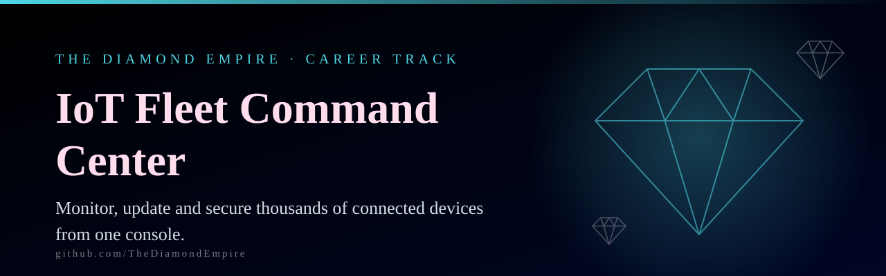

# IoT Fleet Command Center: Client Case Study

> Fewer truck rolls, safer updates and a fleet you can actually see.

> **Status of this document.** This is a reference case study: it sets out the business problem, the solution and the value model. The results table is intentionally blank and is filled in only from measured data (a pilot or a real engagement). No outcome figures are claimed here. The capabilities listed below are the ones the working prototype in this repository implements, exercised against **simulated** devices only; anything not built is marked as such. Experiment results on simulated fleets are in the [research report](research-report.md) and say nothing about any real client's fleet.

## Snapshot

|                   |                                                                                                                                                  |
| ----------------- | ------------------------------------------------------------------------------------------------------------------------------------------------ |
| **Who it is for** | Manufacturers and operators of connected equipment such as EV chargers, energy storage, smart meters, vending machines and agricultural sensors. |
| **Solution**      | Monitor, update and secure thousands of connected devices from one console.                                                                      |
| **Track**         | Career · Advanced                                                                                                                                |
| **Delivered by**  | The Diamond Empire                                                                                                                                   |

## The challenge

Failures surface as customer complaints and truck rolls. Firmware updates are scary, so devices run stale versions for years, and no one can answer which devices are affected by a newly found vulnerability.

## The solution

A device-fleet operations platform for makers and operators of connected equipment. It ingests telemetry over MQTT, tracks health and connectivity, rolls out firmware in safe waves with automatic rollback, and raises de-duplicated, escalating alerts that respect maintenance windows.

What the client gets in practice:

- Device registry with certificate-based identity, hardware and firmware inventory, groups and tags
- MQTT telemetry ingestion with schema validation, back-pressure and per-device rate limits
- Fleet health views: connectivity, battery, error rates and per-model anomaly detection
- Over-the-air firmware campaigns: signed images, staged rollout rings, health gates and automatic pause and rollback
- Alert rules with de-duplication, escalation and maintenance windows
- Multi-tenant access control (viewer, operator, admin roles) and a tamper-evident audit trail of every change
- _Not built yet:_ remote configuration and commands with acknowledgements (planned)

## How it creates value

| Value lever        | How the solution delivers it                                      | How we measure it                                    |
| ------------------ | ----------------------------------------------------------------- | ---------------------------------------------------- |
| Field-service cost | Failing devices are detected and diagnosed remotely               | Truck rolls per 1,000 devices per year               |
| Update safety      | Staged, health-gated rollouts contain bad releases                | Devices affected by faulty releases; rollback time   |
| Time to patch      | Targeted campaigns reach every vulnerable device quickly          | Median days to patch a known vulnerability           |
| Security posture   | Per-device identity and signed firmware shrink the attack surface | Devices on unsupported firmware; revoked credentials |
| Product insight    | Fleet telemetry shows how devices behave in the field             | Failure rate by hardware revision                    |

## How an engagement runs

| Phase   | What happens                                          |
| ------- | ----------------------------------------------------- |
| Assess  | Device types, connectivity and current update process |
| Connect | Pilot cohort of devices onboarded                     |
| Update  | First staged firmware campaign                        |
| Scale   | Full fleet and alert tuning                           |

## What the client receives

- Hosted or self-hosted console
- Device onboarding with certificate provisioning
- First OTA campaign run with the client’s firmware team
- Alert rules tuned to the client’s support process
- Runbooks and training

## Results

Baseline measurements are taken **before** the solution goes live, and the same measures are taken after, so every change in the table is attributable and honest.

| Measure            | How measured                                         | Baseline | After | Change |
| ------------------ | ---------------------------------------------------- | -------- | ----- | ------ |
| Field-service cost | Truck rolls per 1,000 devices per year               | —        | —     | —      |
| Update safety      | Devices affected by faulty releases; rollback time   | —        | —     | —      |
| Time to patch      | Median days to patch a known vulnerability           | —        | —     | —      |
| Security posture   | Devices on unsupported firmware; revoked credentials | —        | —     | —      |
| Product insight    | Failure rate by hardware revision                    | —        | —     | —      |

> **To fill in:** replace each — with measured values and add the measurement window and sample size beneath the table.

## How quality and risk are managed

- Rollout failure drills against simulated fleets: faulty images that fail to boot, degrade telemetry or hang the device, caught by health gates at the first ring and rolled back automatically. One finding to expect in any engagement: a fault that affects only a small share of devices can slip past a small canary ring, so ring sizes and gate thresholds are tuned per fleet rather than assumed (see the research report, experiment E1).
- Firmware-signature verification tests, including tampered images, forged manifests, replayed offers, misdirected offers and downgrade attempts
- Tenant-isolation tests that attack every by-id route from another tenant's account, plus a role matrix test
- A load test of the ingest path on a development machine that reports the ceiling actually reached (see the research report, experiment E3); it is not a statement about production capacity
- A draft [threat model](threat-model.md) for device identity and the update supply chain. It has not been reviewed by a third party
- Not yet drilled: broker restart in the middle of a campaign, and real devices on real networks

## Is this a fit?

Best suited to: manufacturers and operators of connected equipment such as EV chargers, energy storage, smart meters, vending machines and agricultural sensors.

## Talk to me

Want this adapted to your business? Get in touch via **[thedempire.shop](https://thedempire.shop/)**.

---

[README](../README.md) · [Client case study](case-study.md) · [Research report](research-report.md)
