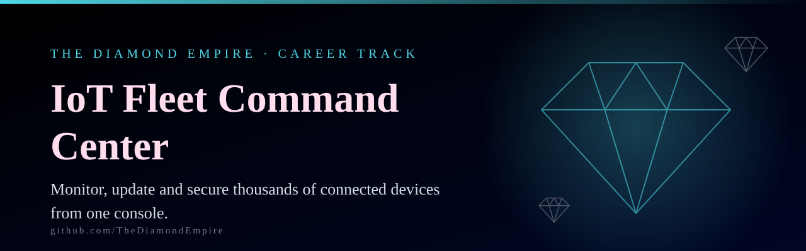

# Threat model (draft, not externally reviewed)

> **Status:** written by the author alongside the prototype. It has **not** been reviewed by anyone else, and the README no longer claims a reviewed threat model. Each row names the automated test that exercises the control; a control without a test is listed as such.

Scope: device identity, the MQTT ingest path, the firmware update chain, and tenant isolation in the API. Out of scope: physical attacks on devices, the host OS, the cloud account, and denial of service beyond the per-device rate limit.

## Assets

1. Firmware signing key (compromise lets an attacker push code to every device).
2. Device private keys and the device CA key (compromise lets an attacker impersonate devices).
3. Tenant data (telemetry, inventory, campaigns, audit trail) and API tokens.
4. Fleet availability during an update.

## Threats and controls

| # | Threat | Control in the prototype | Test |
|---|---|---|---|
| T1 | Stolen device credential used from another machine | Per-device X.509 certificate; revocation is checked at TLS accept and again at CONNECT; live session dropped on revoke | `m1-identity`: revocation test |
| T2 | Device claims another device's identity | `clientId` must equal the certificate identity; certificate subject is set by the registry, never taken from the CSR | `m1-identity`: clientId mismatch, CSR subject |
| T3 | Rogue CA or self-signed certificate | Broker trusts only the platform CA; unknown serials rejected even if CA-signed | `m1-identity`: other CA, unregistered cert |
| T4 | Device reads or writes another tenant's or device's topics | Topic ACL is a pure function of the certificate identity; wildcard subscriptions get a refused SUBACK; foreign publishes close the connection | `m1-identity`: topic ACL |
| T5 | Malformed or oversized telemetry | Size cap, strict schema, range checks, timestamp window; invalid messages dropped and counted | `m1-ingest` |
| T6 | Telemetry flood from one device | Per-device token bucket; store back-pressure pauses reading from publishers | `m1-ingest` |
| T7 | Tampered firmware image | Ed25519 signature over a manifest that contains the SHA-256 of the image; device rejects hash or signature mismatch | `m3-signing`, `m3-campaigns` (over the wire) |
| T8 | Replay of an old offer | Offers carry a unique id (devices remember consumed ids), a device id and tenant id, and a short expiry | `m3-signing`, `m3-campaigns` |
| T9 | Downgrade to a vulnerable but validly signed image | Anti-rollback counter: device refuses any image whose counter is not strictly greater than its own; rollback re-issues known-good firmware under a higher counter | `m3-signing`, `m4-gates` |
| T10 | A signed but faulty release bricks the fleet | Staged rings, health gates on install failures, silence and post-install error/reboot rates, automatic pause and rollback | `m4-gates`, experiment E1 |
| T11 | One tenant reads or changes another tenant's resources through the API | Tenant id comes only from the authenticated principal; foreign ids return 404; every query is scoped | `m5-tenancy` (route sweep, list leaks, id smuggling, injection-shaped ids) |
| T12 | Privilege abuse inside a tenant | Role matrix (viewer, operator, admin); operators cannot release campaigns, revoke devices or read the audit log | `m5-tenancy`: RBAC matrix |
| T13 | Tampering with the audit trail | Per-tenant hash chain; any edit, reorder or mid-chain delete is detected and located | `m5-audit` |

## Known gaps (not mitigated in the prototype)

- **Signing key in a file.** Production needs an HSM or KMS and an approval step; there is no key rotation or revocation of a compromised signing key (devices hold one trusted key).
- **Device CA key in a file**, no CRL or OCSP distribution (revocation is enforced only by the broker's registry lookup), no certificate renewal automation.
- **Audit trail**: an attacker with full database write access can recompute the chain, and truncating the tail is undetectable without an externally stored head hash (both shown in `m5-audit`; anchoring is not built).
- **API tokens** are long random bearer tokens with no expiry, no rotation and no SSO.
- **No API rate limiting**, no brute-force lockout, no TLS on the HTTP API (it binds to 127.0.0.1).
- **Firmware transport** inlines the image in the MQTT offer (size-capped); there is no resumable download, and no check that a device actually booted the verified image (the simulator trusts itself).
- **Replay protection depends on device memory** of consumed offer ids; a device that loses that state is still bounded by the offer expiry and the anti-rollback counter.
- **Gate blind spots**: a fault with low prevalence can pass every ring (shown in experiment E1); the gate only sees what the telemetry schema carries.
- Simulated devices run the verification code in the same process language as the server; no claim is made about embedded implementations.

---

[README](../README.md) · [Client case study](case-study.md) · [Research report](research-report.md)
